# 07-week-7-clean-architecture

## Tujuan 

1. Menjelaskan prinsip SOLID dan separation of concerns dengan contoh kode Flutter;
2. Membedakan struktur feature-first vs layer-first beserta trade-off-nya;
3. Menjelaskan tiga layer (presentation, domain, data) dan aturan dependensi (dependensi mengarah ke dalam);
4. Membedakan entity vs model serta peran repository, use case, dan dependency injection;
5. Merefactor project Minggu 5/6 menjadi struktur feature-first yang terpisah layer-nya;
6. Menguji use case dengan repository palsu tanpa database atau jaringan sungguhan.

---

## Praktikum 1: Audit Layer Project Lama dan Perancangan Clean Architecture

Memeriksa struktur folder dan file pada project `campus_notify` sebelum dilakukan refactoring.

Mengidentifikasi dan memetakan file berdasarkan layer Presentation, Domain, dan Data.

Melakukan audit akses jaringan dan penyimpanan pada folder `lib/pages`. Hasil pemeriksaan menunjukkan **0 temuan** berdasarkan pola yang dicari.

Melakukan audit logika bisnis pada widget. Hasil pemeriksaan menunjukkan **0 temuan** berdasarkan pola yang dicari.

Melakukan audit dependency injection. Ditemukan **1 temuan** pada `lib/providers/auth_provider.dart` baris 13, yaitu `return AuthRepository();`.

Berdasarkan hasil pemeriksaan, project sudah menggunakan Riverpod untuk dependency injection, tetapi kontrak dan implementasi `AuthRepository` masih tergabung dalam satu kelas.

Berikut merupakan struktur project sebelum dilakukan refactoring.

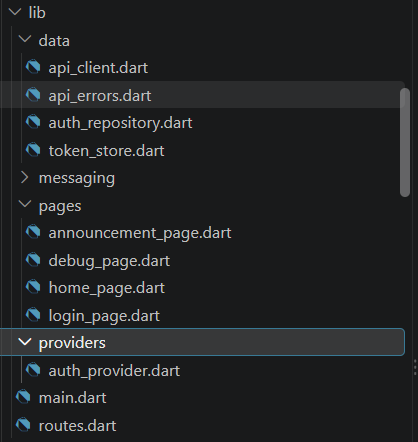

Berikut merupakan hasil audit akses jaringan dan penyimpanan.

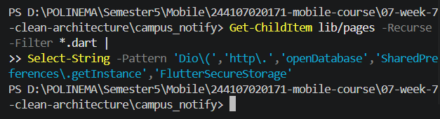

Berikut merupakan hasil audit logika bisnis pada widget.

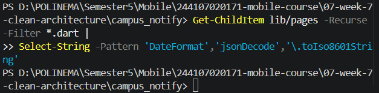

Berikut merupakan hasil audit dependency injection yang menemukan instansiasi `AuthRepository`.


Merancang struktur target Clean Architecture menggunakan pendekatan *feature-first*, dengan pemisahan folder `core`, `features`, dan `shared`, serta layer `presentation`, `domain`, dan `data` pada fitur yang memerlukannya.

Berikut merupakan rancangan struktur target Clean Architecture yang akan digunakan sebagai acuan refactoring.

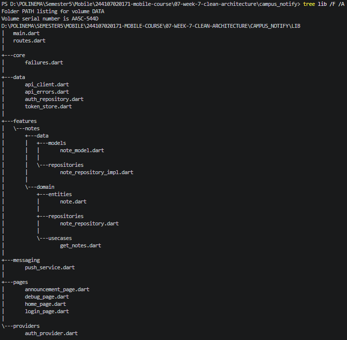

Hasil audit menunjukkan bahwa struktur project masih dikelompokkan berdasarkan jenis komponen dan belum memiliki pemisahan domain layer secara eksplisit. Rancangan Clean Architecture disiapkan agar kode lebih terstruktur, mudah diuji, dan mudah dipelihara tanpa mengubah fungsionalitas aplikasi.

---

## Praktikum 2: Domain dan Data per Fitur

Membuat struktur folder `features/notes` dengan menerapkan pemisahan Domain Layer dan Data Layer menggunakan pendekatan Clean Architecture.

Membuat entity `Note` pada `domain/entities/note.dart` tanpa dependensi Flutter maupun database.

Membuat `Failure` pada `core/failures.dart` untuk menangani kegagalan operasi serta kontrak `NoteRepository` pada `domain/repositories/note_repository.dart` yang mendefinisikan operasi `fetchNotes()` dan `addNote()`.

Membuat `NoteModel` pada Data Layer untuk melakukan konversi data menggunakan `toMap()`, `fromMap()`, dan `toEntity()`.

Mengimplementasikan `NoteRepositoryImpl` menggunakan SQLite melalui package `sqflite` untuk mengambil dan menyimpan catatan serta mengembalikan hasil operasi beserta informasi kegagalan.

Membuat use case `GetNotes` pada Domain Layer sebagai perantara untuk mengakses repository.

Berikut merupakan struktur folder Domain dan Data Layer pada fitur Notes yang telah dibuat.

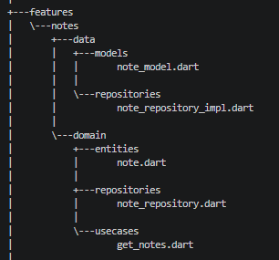

Melakukan pemeriksaan kode menggunakan perintah `flutter analyze`. Hasil pemeriksaan menunjukkan `No issues found!`, sehingga tidak ditemukan error, warning, maupun info dari Dart Analyzer.

Berikut merupakan hasil pemeriksaan kode setelah implementasi Praktikum 2.

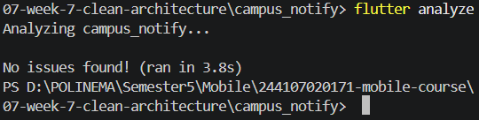

Praktikum 2 menghasilkan pemisahan Domain dan Data Layer pada fitur Notes. Entity dan kontrak repository ditempatkan pada Domain Layer, sedangkan model dan implementasi repository ditempatkan pada Data Layer. Struktur ini menjadi dasar untuk pengembangan fitur Notes pada praktikum berikutnya.

---

## Praktikum 3: Presentation, Dependency Injection, dan Verifikasi

Membuat database opener `notes_database.dart` menggunakan SQLite untuk membuka database dan menyiapkan tabel `notes`.

Mengimplementasikan dependency injection menggunakan Riverpod pada `notes_providers.dart` untuk menghubungkan `NoteRepositoryImpl`, `NoteRepository`, dan use case `GetNotes`.

Membuat halaman `NotesPage` pada Presentation Layer yang hanya membaca state dari `notesProvider` tanpa mengakses SQL, Dio, maupun database secara langsung.

Menambahkan route `/notes` pada konfigurasi GoRouter dan tombol **Buka Catatan** pada halaman utama agar fitur Notes dapat diakses.

Melakukan pemeriksaan dependency rule untuk memastikan Presentation Layer tidak menggunakan akses data mentah secara langsung.

Berikut merupakan hasil audit Presentation Layer.

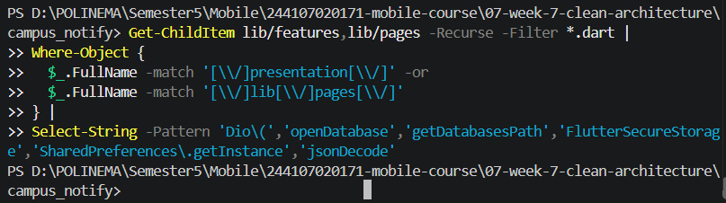

Melakukan pemeriksaan Domain Layer untuk memastikan tidak terdapat import langsung dari Flutter, Dio, SQLite, maupun Firebase berdasarkan pola yang diperiksa.

Berikut merupakan hasil audit Domain Layer.

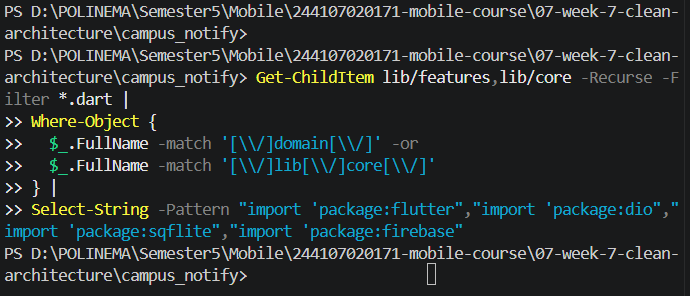

Menjalankan `flutter analyze` untuk memeriksa kode setelah implementasi Presentation Layer dan dependency injection.

Berikut merupakan hasil pemeriksaan Dart Analyzer.

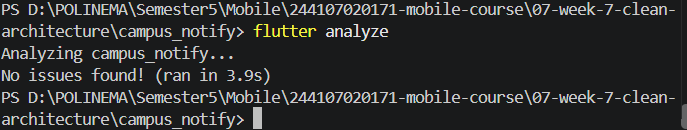

Menjalankan `flutter test` untuk memeriksa apakah pengujian yang tersedia tetap berhasil setelah penambahan fitur Notes.

Berikut merupakan hasil pengujian aplikasi.

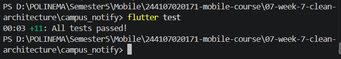

Memeriksa struktur folder fitur Notes yang telah dipisahkan menjadi Domain Layer, Data Layer, dan Presentation Layer.

Berikut merupakan struktur fitur Notes setelah penerapan Clean Architecture.

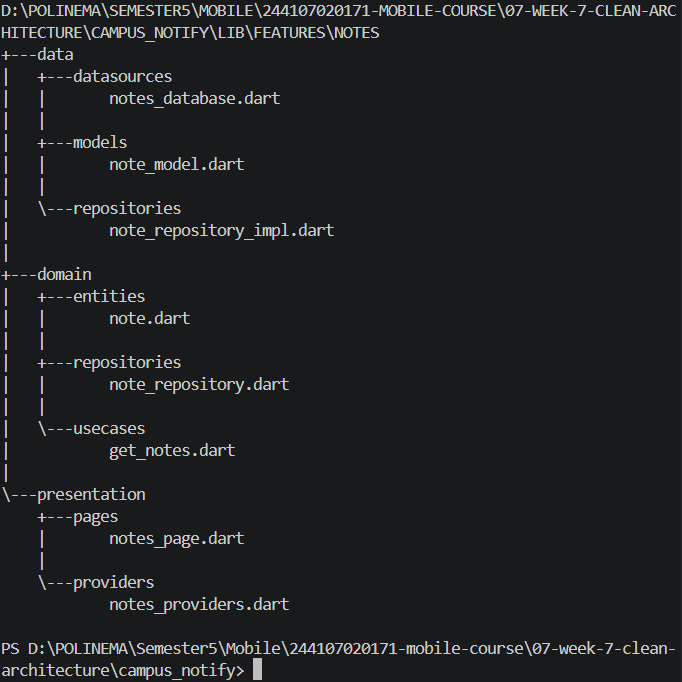

Menjalankan aplikasi melalui Android Emulator, kemudian melakukan login dan membuka halaman Notes melalui tombol **Buka Catatan**.

Halaman Notes berhasil ditampilkan dengan judul **Catatan** dan pesan **Belum ada catatan.** karena belum terdapat data catatan yang tersimpan.

Berikut merupakan tampilan halaman Notes ketika belum terdapat catatan.

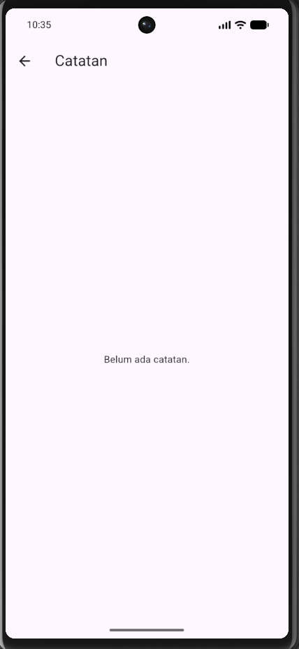

Praktikum 3 menghasilkan integrasi Domain Layer, Data Layer, dan Presentation Layer pada fitur Notes menggunakan Riverpod sebagai dependency injection. Halaman Notes berhasil ditampilkan tanpa mengakses database secara langsung dari widget. Struktur ini memisahkan tanggung jawab setiap layer sehingga kode lebih terorganisasi, mudah diuji, dan mudah dikembangkan.

---

## AI Challenge

### 1. Agent yang Dipakai

ChatGPT (GPT-6).

### 2. Prompt yang Digunakan

```text
Project Flutter saya: campus_notify (auth + FCM + daftar pengumuman).
Kondisi kini: folder lib/{data, providers, pages, messaging},
repository tercampur dengan implementasi, widget memanggil Dio langsung.

Tugas:
1. Usulkan struktur feature-first Clean Architecture
   (presentation/domain/data) untuk fitur auth + announcements.
2. Untuk tiap file lama, sebutkan tujuan barunya (pindah/pecah/hapus).
3. Tandai bagian yang over-engineering bila diterapkan ke CRUD sederhana,
   dan kapan use case benar-benar dibutuhkan vs repository langsung.
4. Tunjukkan wiring DI dengan Riverpod (tanpa package DI tambahan).

Jelaskan trade-off setiap keputusan.
```

### 3. Output Awal AI

ChatGPT menghasilkan usulan penerapan Clean Architecture menggunakan pendekatan *feature-first* pada aplikasi `campus_notify`. Usulan ini berfokus pada pemisahan tanggung jawab antara Presentation Layer, Domain Layer, dan Data Layer, khususnya pada fitur autentikasi dan pengumuman.

Berdasarkan hasil audit Praktikum 1, project sudah menggunakan Riverpod untuk dependency injection, tetapi `AuthRepository` masih berupa kelas konkret yang menggabungkan kontrak dan implementasi. Sementara itu, fitur Notes yang dibuat pada Praktikum 2 dan 3 sudah menggunakan pemisahan layer.

#### a. Usulan Struktur Feature-First Clean Architecture

```text
lib/
├── main.dart
├── routes.dart
├── core/
│   ├── errors/
│   │   └── api_errors.dart
│   └── network/
│       └── api_client.dart
├── features/
│   ├── auth/
│   │   ├── domain/
│   │   │   ├── entities/
│   │   │   │   └── auth_session.dart
│   │   │   └── repositories/
│   │   │       └── auth_repository.dart
│   │   ├── data/
│   │   │   ├── datasources/
│   │   │   │   └── token_store.dart
│   │   │   └── repositories/
│   │   │       └── auth_repository_impl.dart
│   │   └── presentation/
│   │       ├── pages/
│   │       │   └── login_page.dart
│   │       └── providers/
│   │           └── auth_provider.dart
│   ├── announcements/
│   │   ├── domain/
│   │   │   ├── entities/
│   │   │   │   └── announcement.dart
│   │   │   └── repositories/
│   │   │       └── announcement_repository.dart
│   │   ├── data/
│   │   │   ├── models/
│   │   │   │   └── announcement_model.dart
│   │   │   └── repositories/
│   │   │       └── announcement_repository_impl.dart
│   │   └── presentation/
│   │       └── pages/
│   │           └── announcement_page.dart
│   └── notes/
│       ├── domain/
│       ├── data/
│       └── presentation/
├── messaging/
│   └── push_service.dart
└── pages/
    ├── home_page.dart
    └── debug_page.dart
```

Struktur tersebut merupakan rancangan awal AI, bukan struktur yang seluruhnya sudah diimplementasikan. Pemisahan Auth dan Announcements dapat dilakukan secara bertahap tanpa mengubah fitur Notes yang sudah menerapkan Clean Architecture.

#### b. Pemetaan File Lama ke Struktur Baru

| File Lama | Usulan Perubahan | Keterangan |
| --- | --- | --- |
| `data/auth_repository.dart` | Pecah menjadi entity, interface, dan implementation | Memisahkan kontrak dari implementasi |
| `data/token_store.dart` | Pindah ke `auth/data/datasources/` | Penyimpanan token merupakan tanggung jawab Data Layer |
| `providers/auth_provider.dart` | Pindah ke `auth/presentation/providers/` | Mengelola state autentikasi dan dependency |
| `pages/login_page.dart` | Pindah ke `auth/presentation/pages/` | Bagian dari fitur autentikasi |
| `pages/announcement_page.dart` | Pindah ke `announcements/presentation/pages/` | Bagian dari fitur pengumuman |
| `data/api_client.dart` | Pindah ke `core/network/` | Komponen jaringan yang dapat digunakan bersama |
| `data/api_errors.dart` | Pindah ke `core/errors/` | Penanganan error API |
| `messaging/push_service.dart` | Dipertahankan sementara | Menghindari perubahan FCM yang tidak diperlukan |
| `pages/home_page.dart` | Dipertahankan sementara | Halaman utama aplikasi |
| `pages/debug_page.dart` | Dipertahankan sementara | Halaman debug FCM |
| `main.dart` dan `routes.dart` | Tetap | Menjaga konfigurasi aplikasi dan navigasi |

Usulan penambahan entity, model, dan repository untuk fitur Announcements perlu disesuaikan dengan implementasi sebenarnya. Apabila halaman hanya menampilkan informasi statis, penambahan seluruh komponen tersebut belum tentu diperlukan.

#### c. Identifikasi Over-Engineering dan Penggunaan Use Case

ChatGPT menjelaskan bahwa Clean Architecture tidak mengharuskan setiap operasi CRUD memiliki use case tersendiri.

Untuk operasi sederhana seperti mengambil daftar catatan, Presentation Layer dapat memanggil kontrak repository secara langsung melalui Riverpod.

Contoh:

```dart
final notesProvider = FutureProvider<List<Note>>((ref) async {
  final repository = ref.watch(noteRepositoryProvider);
  final result = await repository.fetchNotes();

  if (result.failure != null) {
    throw Exception(result.failure!.message);
  }

  return result.notes;
});
```

Sementara itu, use case lebih bermanfaat ketika suatu operasi memiliki aturan bisnis, validasi, atau melibatkan beberapa repository.

| Kondisi | Rekomendasi AI | Alasan |
| --- | --- | --- |
| CRUD sederhana | Repository langsung melalui provider | Mengurangi boilerplate |
| Operasi dengan validasi bisnis | Gunakan use case | Memisahkan aturan bisnis dari UI |
| Operasi melibatkan beberapa repository | Gunakan use case | Mengatur koordinasi proses |
| Autentikasi dengan pengelolaan sesi | Pertimbangkan use case | Memisahkan alur autentikasi dari state UI |
| Setiap operasi dibuatkan use case tanpa logika tambahan | Tidak disarankan | Berpotensi over-engineering |

Pada Praktikum 2, use case `GetNotes` tetap dibuat sesuai instruksi modul. Namun, secara teknis operasi sederhana tersebut juga dapat menggunakan repository secara langsung.

#### d. Dependency Injection Menggunakan Riverpod

ChatGPT mengusulkan agar dependency injection tetap menggunakan Riverpod tanpa menambahkan package DI seperti GetIt.

Contoh rancangan wiring repository autentikasi setelah pemisahan kontrak dan implementasi:

```dart
final authRepositoryProvider = Provider<AuthRepository>((ref) {
  return AuthRepositoryImpl();
});
```

Pada rancangan tersebut, `AuthRepository` merupakan interface pada Domain Layer, sedangkan `AuthRepositoryImpl` merupakan implementasi pada Data Layer.

Sebagai pembanding, fitur Notes sudah menerapkan pola serupa:

```dart
final noteRepositoryProvider = Provider<NoteRepository>((ref) {
  return NoteRepositoryImpl(openDb: openNotesDb);
});

final getNotesProvider = Provider<GetNotes>((ref) {
  return GetNotes(ref.watch(noteRepositoryProvider));
});
```

Penggunaan Riverpod memungkinkan repository diganti dengan implementasi palsu (*fake repository*) saat pengujian tanpa mengubah widget.

#### e. Trade-Off Usulan AI

| Usulan AI | Keuntungan | Kekurangan |
| --- | --- | --- |
| Feature-first | Struktur lebih mudah dikembangkan berdasarkan fitur | Memerlukan pemindahan file dan pembaruan import |
| Pemisahan interface dan implementation | Mempermudah pengujian dan penggantian sumber data | Menambah jumlah file |
| Use case untuk operasi kompleks | Aturan bisnis lebih terisolasi | Menambah lapisan abstraksi |
| Use case untuk seluruh CRUD | Konsistensi struktur | Boilerplate berlebihan untuk operasi sederhana |
| Riverpod sebagai DI | Tidak membutuhkan package tambahan | Pengelolaan provider harus tetap terorganisasi |
| Refactoring seluruh fitur sekaligus | Struktur akhir lebih seragam | Risiko regresi pada autentikasi, navigasi, dan FCM |

### 4. AI Verification Checklist

#### a. Apakah interface repository berada di Domain dan implementasi di Data?

Jawaban: Ya, pemisahan interface repository dan implementasinya sudah diterapkan pada fitur Notes dan Auth.

Pada fitur Auth, interface AuthRepository ditempatkan pada lib/features/auth/domain/repositories/auth_repository.dart, sedangkan implementasinya berada pada lib/features/auth/data/repositories/auth_repository_impl.dart.

Pada fitur Notes, interface NoteRepository berada pada features/notes/domain/repositories/, sedangkan implementasi NoteRepositoryImpl berada pada features/notes/data/repositories/.

Pemisahan ini sesuai dengan prinsip Dependency Inversion karena Domain Layer bergantung pada abstraksi, bukan implementasi konkret. Dependency injection dilakukan menggunakan Riverpod sehingga implementasi repository dapat diganti dengan fake repository saat pengujian.

#### b. Apakah Domain Layer bebas dari import Flutter, Dio, SQLite, dan Firebase?

Jawaban: Ya, berdasarkan hasil pemeriksaan menggunakan PowerShell, tidak ditemukan import Flutter, Dio, SQLite, maupun Firebase pada file Domain Layer dan Core yang diperiksa.

Pemeriksaan dilakukan menggunakan Get-ChildItem, Where-Object, dan Select-String untuk mencari import framework dan package eksternal.

Berikut merupakan hasil verifikasi import pada Domain Layer.

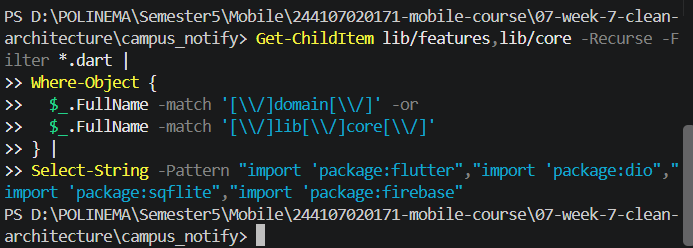

Hasil verifikasi: 0 temuan.

Hasil tersebut menunjukkan bahwa tidak terdapat import yang sesuai dengan pola pencarian, sehingga pemisahan Domain Layer dari framework eksternal telah memenuhi pemeriksaan yang dilakukan.

#### c. Apakah AI membuat use case untuk setiap operasi CRUD sederhana?

Jawaban: Tidak.

AI menyarankan penggunaan repository secara langsung untuk operasi CRUD sederhana yang tidak memiliki aturan bisnis tambahan.

Use case disarankan ketika terdapat validasi, koordinasi beberapa repository, atau proses bisnis yang perlu dipisahkan dari Presentation Layer.

Keputusan ini diterima karena mengurangi risiko over-engineering.

#### d. Apakah Entity bebas dari proses mapping?

Jawaban: Ya, berdasarkan hasil pemeriksaan, tidak ditemukan metode toMap(), fromMap(), toJson(), maupun fromJson() pada file Domain Layer.

Berikut merupakan hasil verifikasi metode mapping pada Domain Layer.

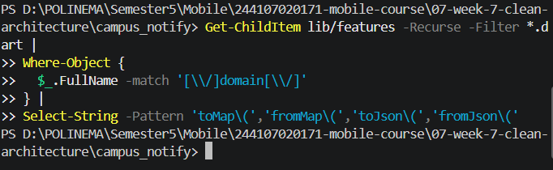

Hasil verifikasi: 0 temuan.

Hal ini sesuai dengan prinsip Clean Architecture bahwa entity berfokus pada representasi data dan aturan domain, sedangkan proses konversi data ditempatkan pada model di Data Layer.

#### e. Apakah wiring DI terpusat di provider dan widget tidak membuat repository sendiri?

Jawaban: Pada fitur Notes, dependency injection telah menggunakan Riverpod melalui noteRepositoryProvider dan getNotesProvider. Widget membaca state melalui provider tanpa membuat repository secara langsung.

Pemeriksaan tambahan pada Presentation Layer dilakukan untuk mencari pola akses langsung terhadap Dio, SQLite, Flutter Secure Storage, SharedPreferences, dan jsonDecode.

Berikut merupakan hasil verifikasi akses data langsung pada Presentation Layer.

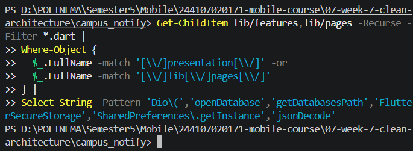

Hasil verifikasi: 0 temuan.

Hasil tersebut menunjukkan bahwa tidak ditemukan pola akses data langsung yang diperiksa pada Presentation Layer. Namun, pemeriksaan ini tidak secara menyeluruh membuktikan bahwa seluruh pembuatan repository telah terpusat pada provider.

#### f. Keputusan Final dan Alasan Teknis

Berdasarkan evaluasi terhadap usulan ChatGPT, keputusan akhir adalah menerapkan Clean Architecture secara bertahap dengan mempertimbangkan kompleksitas setiap fitur.

| Usulan AI | Keputusan Final | Alasan Teknis |
| --- | --- | --- |
| Struktur feature-first | Diterima sebagai rancangan | Memudahkan pengelompokan kode berdasarkan fitur |
| Pemisahan repository interface dan implementation | Diterapkan pada Notes dan Auth | Mempermudah pengujian dan mengurangi ketergantungan pada kelas konkret |
| Use case untuk setiap CRUD | Ditolak | Menambah boilerplate tanpa manfaat signifikan |
| Use case untuk operasi kompleks | Diterima | Memisahkan aturan bisnis dari Presentation Layer |
| Riverpod untuk dependency injection | Dipertahankan | Sudah digunakan dan tidak membutuhkan package tambahan |
| Repository tambahan untuk Announcements | Ditunda | Perlu memeriksa kebutuhan dan sumber data sebenarnya |
| Refactoring seluruh fitur sekaligus | Ditolak | Berisiko mengganggu autentikasi, routing, dan FCM |
| Mempertahankan implementasi Notes | Diterima | Sudah menerapkan pemisahan Domain, Data, dan Presentation |

---

## Refactoring, testing, dan error umum

Refactoring yang diterapkan:

- Fitur Auth direfactor menggunakan pendekatan **Clean Architecture** dengan pemisahan layer `domain`, `data`, dan `presentation` pada folder `lib/features/auth/`.
- `lib/features/auth/domain/entities/auth_session.dart` mendefinisikan entitas sesi autentikasi, sedangkan `domain/repositories/auth_repository.dart` menyediakan kontrak repository dan `domain/usecases/login.dart` menangani proses login melalui repository.
- `lib/features/auth/data/repositories/auth_repository_impl.dart` mengimplementasikan proses login dan refresh token, dengan mengembalikan `Failure` ketika terjadi kegagalan.
- `lib/features/auth/data/datasources/token_store.dart` menangani penyimpanan access token dan refresh token menggunakan `FlutterSecureStorage`.
- `lib/features/auth/presentation/providers/auth_provider.dart` menghubungkan repository, use case, dan state autentikasi menggunakan Riverpod. `LoginPage` dipindahkan ke `features/auth/presentation/pages/` agar sesuai dengan struktur feature-first.
- `lib/data/api_client.dart` disesuaikan dengan kontrak `AuthRepository` baru untuk menangani header Bearer, refresh token, pembatasan retry HTTP 401, dan penghapusan sesi ketika refresh gagal.
- `lib/core/format.dart` menyediakan fungsi murni `formatDate()`, `routeFromMessage()`, dan `routeFromPath()`. Fungsi parsing route dipisahkan dari `lib/routes.dart`, sedangkan `routes.dart` tetap menyediakan konstanta `AppRoutes` dan mengekspor helper route agar navigasi FCM tetap kompatibel.
- `test/auth_push_test.dart` diperbarui menggunakan repository dan token storage dari struktur Auth baru. Pengujian mencakup parsing route, sesi autentikasi, kegagalan refresh token, header Authorization, dan pemetaan error API.
- `test/get_notes_test.dart` menggunakan `FakeNoteRepository` untuk menguji use case `GetNotes` dalam kondisi berhasil, data kosong, dan gagal tanpa mengakses SQLite atau jaringan.
- `test/format_test.dart` menguji format tanggal `DD/MM/YYYY`, termasuk penambahan angka nol pada tanggal dan bulan.

### Perbaikan error saat refactoring

Selama proses refactoring, ditemukan error karena kelas `TokenStore` dan `AuthRepository` masih digunakan dari dua lokasi berbeda, yaitu folder `lib/data/` dan `lib/features/auth/`. Meskipun memiliki nama yang sama, Dart menganggap kelas dari kedua lokasi tersebut sebagai tipe yang berbeda sehingga muncul error `argument_type_not_assignable`.

Perbaikan dilakukan dengan memperbarui import pada provider, API client, halaman aplikasi, dan unit test agar menggunakan implementasi Auth yang baru. File `TokenStore` pada struktur baru juga dipastikan berisi definisi kelas yang lengkap untuk mengatasi error `The name 'TokenStore' isn't a type`.

Selain itu, `test/auth_push_test.dart` disesuaikan dengan perubahan kontrak `AuthRepository`, terutama metode `refresh()` yang sebelumnya mengembalikan `Future<String>` menjadi record yang berisi `access` dan `Failure`.

### Pengujian hasil refactoring

Pengujian dilakukan menggunakan flutter analyze dan flutter test. Hasil akhir menunjukkan No issues found! pada analyzer dan 16 tests passed setelah penambahan pengujian GetNotes dan formatDate.

Berikut merupakan bukti hasil pengujian dan analisis kode:

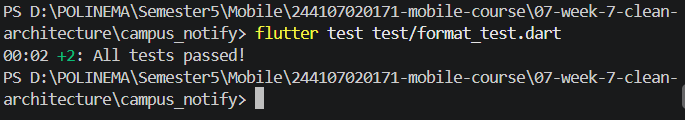

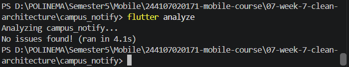

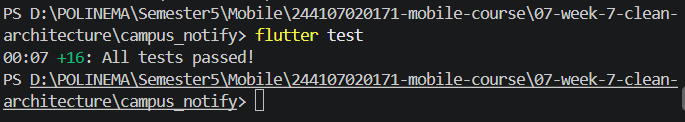

---

## Mini Project

1. Refactor fitur Notes menjadi Clean Architecture feature-first dengan pemisahan domain/ (entity, repository interface, use case), data/ (model, repository implementation), dan presentation/ (Riverpod provider dan halaman Notes).

2. Terapkan dependency rule agar domain tidak bergantung pada presentation, data, maupun framework eksternal. Buktikan melalui tiga pemeriksaan grep sterilitas dan dokumentasikan hasilnya di README.

3. Pertahankan behavior aplikasi sebelum dan sesudah refactoring, termasuk login, navigasi, dan pengelolaan catatan. Sertakan screenshot before/after pada folder screenshots/.

4. Buat unit test untuk use case GetNotes menggunakan FakeNoteRepository dengan skenario pengambilan catatan berhasil, data kosong, dan kegagalan tanpa menggunakan SQLite sungguhan.

5. Refactor fitur Auth dengan memisahkan entity, repository interface, repository implementation, use case login, token storage, serta Riverpod provider sesuai prinsip Clean Architecture.

6. Pindahkan fungsi format tanggal dan parsing route ke lib/core/format.dart agar dapat diuji secara terpisah tanpa bergantung pada UI.

7. Kerjakan AI Challenge dan dokumentasikan prompt, tabel perbandingan usulan AI dengan keputusan final, serta alasan teknis penerapan arsitektur pada folder docs/ dan README.

8. Jalankan flutter analyze dan flutter test untuk memastikan perubahan struktur tidak menimbulkan error dan pengujian tetap berhasil.

9. Push project ke repository portfolio pada folder 07-week-7-clean-architecture/ dengan struktur lib/, test/, docs/, README.md, dan screenshots/. README menjelaskan tujuan, diagram layer dan arah dependensi, fitur utama, stack teknologi, cara menjalankan, serta hasil implementasi.

---

## Refleksi

1. Mengapa interface repository harus tinggal di domain, bukan di data? Apa yang rusak bila dibalik?

Jawaban: Karena domain harus mendefinisikan kebutuhan bisnis tanpa bergantung pada cara penyimpanan data. Jika interface repository ditempatkan pada data layer, domain menjadi bergantung pada data sehingga melanggar dependency rule, menyulitkan penggantian sumber data, dan mengurangi kemudahan unit testing.

2. Kapan use case benar-benar dibutuhkan, dan kapan repository langsung ke notifier sudah cukup?

Jawaban: Use case dibutuhkan ketika terdapat aturan bisnis, validasi, atau proses yang melibatkan beberapa operasi repository. Repository langsung ke notifier dapat digunakan untuk operasi sederhana yang hanya mengambil atau menyimpan data tanpa logika bisnis tambahan. Pada project ini, GetNotes menggunakan use case agar logika domain dapat diuji secara terpisah.

3. Apa biaya over-engineering (use case per CRUD satu-baris) bagi tim kecil? Kapan biayanya sepadan?

Jawaban: Over-engineering menambah jumlah file, boilerplate, dan waktu pemeliharaan sehingga pengembangan menjadi lebih rumit. Biaya tersebut sepadan ketika aplikasi memiliki aturan bisnis kompleks, banyak pengembang, atau membutuhkan pengujian dan pengembangan jangka panjang. Untuk operasi CRUD sederhana, use case tambahan tidak selalu diperlukan.

4. Bagian mana dari usulan AI yang Anda tolak atau sederhanakan, dan mengapa?

Jawaban: Saya menyederhanakan usulan pembuatan use case untuk setiap operasi CRUD karena sebagian operasi hanya meneruskan pemanggilan repository tanpa aturan bisnis tambahan. Saya juga memilih refactoring secara bertahap, dimulai dari Notes kemudian Auth, agar fitur yang sudah berjalan tidak terganggu dan setiap perubahan dapat diperiksa melalui analyzer serta unit test.

---

## Kesimpulan

Pada Week 7, telah diterapkan Clean Architecture dengan pendekatan feature-first melalui pemisahan layer domain, data, dan presentation. Refactoring dilakukan pada fitur Notes dan Auth, serta pemisahan fungsi format tanggal dan parsing route ke core/format.dart.

Pengujian menggunakan flutter analyze dan flutter test menunjukkan hasil No issues found! dan 16 pengujian berhasil. Melalui AI Challenge, penerapan Clean Architecture disesuaikan dengan kebutuhan project agar kode lebih terstruktur, mudah diuji, dan tidak mengalami over-engineering.