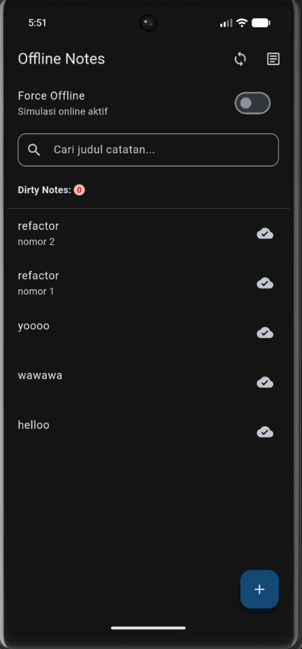
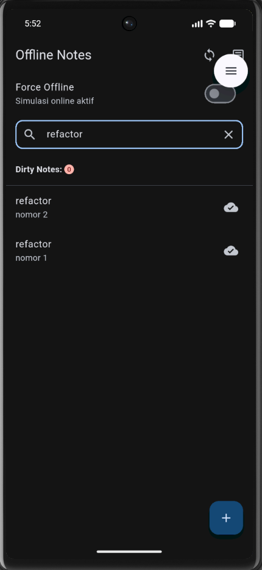
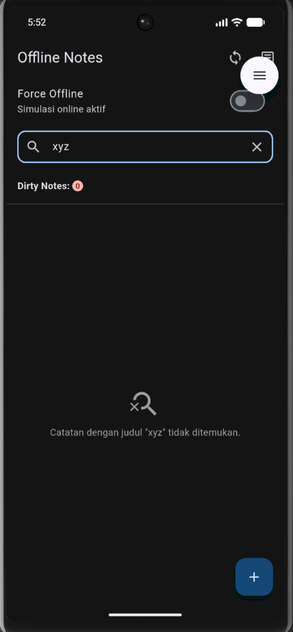
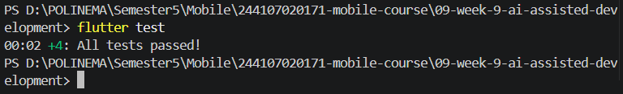

# 09-week-9-ai-assisted-development

## Tujuan Pembelajaran

Setelah menyelesaikan praktikum ini, mahasiswa mampu:
1. Menjelaskan workflow *AI-assisted development* (`prompt`, `generate`, `verify`, `test`, `refactor`, `explain`);
2. Menulis prompt dan konteks yang efektif untuk fitur Flutter kecil menggunakan Formula 5 Slot;
3. Mengenali halusinasi dan keterbatasan AI pada kode Flutter (seperti method fiktif, package kadaluarsa, dan logika keliru);
4. Melakukan debugging dan refactoring kode hasil AI agar tetap mematuhi prinsip arsitektur yang bersih;
5. Menguji kode hasil AI menggunakan `flutter analyze` dan unit test otomatis hingga bersih;
6. Mendokumentasikan prompt, hasil AI, keputusan terima/tolak, dan bukti uji secara sistematis pada `docs/ai-log.md`.

---

## Praktikum 1: Prompt dan Context Engineering

### A. Formula 5 Slot

Penyusunan prompt pada praktikum ini menggunakan metode **Formula 5 Slot** untuk memastikan AI menerima batasan teknis yang jelas tanpa menimbulkan ambiguitas arsitektur:

1. **Peran (*Role*):** Senior Flutter Developer.
2. **Konteks (*Context*):** Project Flutter Offline Notes menggunakan `flutter_riverpod: ^3.4.3`, SQLite (`sqflite`), model `Note`, dan repository pattern pada `lib/data/repositories/note_repository.dart`.
3. **Tugas (*Task*):** Menambahkan fitur pencarian catatan berdasarkan judul (`searchNotes(String query)`) dan penanganan *empty state* saat hasil pencarian tidak ditemukan.
4. **Batas (*Constraints*):**
   - Akses data wajib melalui `NoteRepository` (tidak boleh memanggil query SQLite langsung dari widget).
   - Logika pencarian harus mengabaikan perbedaan huruf besar/kecil (*case-insensitive*).
   - Menjaga perubahan kode tetap modular dan di bawah 80 baris.
5. **Output (*Deliverables*):** Potongan kode repository, provider, integrasi UI search bar + empty state, 3 skenario unit test, dan panduan pengujian manual.

### B. Prompt yang Diterapkan

```text
Peran: Senior Flutter Developer
Konteks: Project Flutter Offline Notes menggunakan Riverpod 3.x (flutter_riverpod), SQLite (sqflite), dan repository pattern (NoteRepository, model Note, notesProvider di lib/pages/notes_page.dart).
Tugas: Tambahkan fitur pencarian catatan berdasarkan judul (search notes) beserta penanganan empty state ketika hasil pencarian tidak ditemukan.
Batas:
1. Jangan panggil SQLite langsung dari widget (akses data wajib melalui NoteRepository).
2. Hindari bug case-sensitive pada pencarian judul.
3. Jangan ubah arsitektur dasar dan batasi perubahan kode di bawah 80 baris.
4. Jangan sertakan secret/token atau dependensi eksternal yang tidak diperlukan.
Output:
1. Potongan kode penambahan method di NoteRepository.
2. Provider Riverpod dan integrasi SearchBar + Empty State pada NotesPage.
3. 3 skenario unit test (pencarian cocok, case-insensitive, dan kata kunci tidak ditemukan).
4. Langkah pengujian manual.
```

### C. Prinsip Context & Privasi

- **Pemberian Konteks Tepat Sasaran:** Hanya menyertakan struktur antarmuka `NoteRepository`, tipe data entitas `Note`, dan versi paket terkait.
- **Perlindungan Privasi & Keamanan:** Tidak menyertakan token autentikasi, API keys, kredensial database, atau informasi sensitif pada prompt AI.

---

## Implementasi Fitur Search & Empty State

### 1. Penambahan Method Repository (`lib/data/repositories/note_repository.dart`)

Pencarian dilakukan pada lapisan database menggunakan filter SQL `LIKE` yang efisien dan aman dari SQL injection:

```dart
Future<List<Note>> searchNotes(String query) async {
  final trimmed = query.trim();
  if (trimmed.isEmpty) {
    return fetchNotes();
  }
  final db = await _openDb();
  final rows = await db.query(
    'notes',
    where: 'title LIKE ?',
    whereArgs: ['%$trimmed%'],
    orderBy: 'updated_at DESC',
  );
  return rows.map(Note.fromMap).toList();
}
```

### 2. Notifier State Management (`lib/pages/notes_page.dart`)

Menggunakan `Notifier` resmi dari Riverpod 3.x untuk mengelola query pencarian secara terenkapsulasi:

```dart
class SearchQueryNotifier extends Notifier<String> {
  @override
  String build() => '';

  void setQuery(String query) => state = query;
  void clear() => state = '';
}

final searchQueryProvider =
    NotifierProvider<SearchQueryNotifier, String>(SearchQueryNotifier.new);

final notesProvider = FutureProvider<List<Note>>(
  (ref) {
    final query = ref.watch(searchQueryProvider);
    return ref.watch(noteRepositoryProvider).searchNotes(query);
  },
);
```

### 3. Komponen Antarmuka Search Bar & Empty State

Menyediakan kolom pencarian dengan tombol pembersih (*clear*) serta membedakan tampilan jika catatan belum dibuat vs hasil pencarian nihil:

```dart
// Kolom Input Pencarian
Padding(
  padding: const EdgeInsets.symmetric(horizontal: 16, vertical: 8),
  child: TextField(
    controller: _searchController,
    decoration: InputDecoration(
      hintText: 'Cari judul catatan...',
      prefixIcon: const Icon(Icons.search),
      suffixIcon: ref.watch(searchQueryProvider).isNotEmpty
          ? IconButton(
              icon: const Icon(Icons.clear),
              onPressed: () {
                _searchController.clear();
                ref.read(searchQueryProvider.notifier).clear();
              },
            )
          : null,
      border: OutlineInputBorder(borderRadius: BorderRadius.circular(12)),
      contentPadding: const EdgeInsets.symmetric(horizontal: 16),
    ),
    onChanged: (value) => ref.read(searchQueryProvider.notifier).setQuery(value),
  ),
),

// Tampilan Empty State Informatif
notes.isEmpty
    ? Center(
        child: Column(
          mainAxisSize: MainAxisSize.min,
          children: [
            Icon(
              query.isNotEmpty ? Icons.search_off : Icons.note_alt_outlined,
              size: 48,
              color: Colors.grey,
            ),
            const SizedBox(height: 8),
            Text(
              query.isNotEmpty
                  ? 'Catatan dengan judul "$query" tidak ditemukan.'
                  : 'Belum ada catatan.',
              style: const TextStyle(color: Colors.grey),
            ),
          ],
        ),
      )
    : ListView.builder(...);
```

#### Bukti Tampilan Antarmuka Aplikasi

Berikut merupakan tampilan awal halaman catatan yang dilengkapi kolom pencarian (*search bar*):



Berikut merupakan tampilan ketika dilakukan pencarian judul catatan yang cocok (*search filter match*):



Berikut merupakan tampilan *Empty State* informatif ketika kata kunci pencarian tidak ditemukan pada catatan:



---

## Verifikasi & Refactoring Kode Hasil AI

Hasil generate awal dari AI diperiksa secara kritis terhadap kode nyata dan standar Flutter terbaru. Rincian selengkapnya terdokumentasi pada [docs/ai-log.md](docs/ai-log.md).

Ringkasan hasil evaluasi:
1. **Halusinasi Versi Paket (*Package Obsolete*):** AI mengusulkan `StateProvider` yang sudah ditinggalkan di Riverpod 3.x (`flutter_riverpod: ^3.4.3`). Kode langsung direfactor menjadi `NotifierProvider` dan kelas `Notifier`.
2. **Kesalahan Signature Lifecycle:** AI mengusulkan `Widget build(BuildContext context, WidgetRef ref)` di dalam `ConsumerState`. Pada `ConsumerState`, `ref` diakses langsung sebagai properti kelas sehingga signature dikoreksi menjadi `Widget build(BuildContext context)`.
3. **Penyempurnaan Penanganan Spasi (*Edge Case*):** AI tidak melakukan sanitasi `trim()` sebelum memproses query. Dilakukan perbaikan agar query kosong/spasi langsung diarahkan kembali memanggil `fetchNotes()`.
4. **Penyempurnaan UX:** Menambahkan icon button `Icons.clear` untuk mereset kata kunci dan membedakan icon serta teks empty state.

---

## Pengujian dan Static Analysis

### 1. Static Analysis (`flutter analyze`)

Pemeriksaan Dart analyzer memastikan tidak ada syntax error, warning, maupun pelanggaran lint rules:

```bash
flutter analyze
```

Hasil:
```text
Analyzing 09-week-9-ai-assisted-development...                  
No issues found! (ran in 3.7s)
```

### 2. Dart Formatter (`dart format`)

Seluruh file Dart diformat sesuai standar resmi:

```bash
dart format --set-exit-if-changed lib test
```

Hasil:
```text
Formatted 19 files (0 changed) in 0.04 seconds.
```

### 3. Automated Testing (`flutter test`)

Pengujian otomatis mencakup pengujian bawaan model/provider ditambah 4 skenario unit test baru untuk fitur pencarian catatan:

```bash
flutter test
```

Hasil:
```text
00:00 +0: fromMap aman terhadap field yang hilang
00:00 +1: flag dirty bertahan pada serialisasi
00:00 +2: provider sukses dengan repository palsu
00:00 +3: provider error dengan repository palsu
00:00 +4: searchNotes menemukan catatan yang cocok berdasarkan judul (partial match)
00:00 +5: searchNotes bersifat case-insensitive
00:00 +6: searchNotes mengembalikan list kosong (empty state) jika query tidak cocok
00:00 +7: provider notesProvider reaktif terhadap perubahan searchQueryProvider
00:00 +8: All tests passed!
```
**Total: 8 pengujian berhasil dijalankan (100% Passed).**

Berikut merupakan bukti tangkapan layar eksekusi pengujian otomatis pada terminal:



---

## Refleksi

1. **Apa perbedaan mendasar antara *AI-assisted development* dan *vibe coding*?**
   *AI-assisted development* menempatkan pengembang sebagai penentu keputusan yang secara aktif membaca, memverifikasi kesesuaian API, menguji, dan me-refactor setiap baris kode yang diusulkan AI. Sebaliknya, *vibe coding* menerima hasil AI secara mentah tanpa pemahaman teknis atau pengujian, yang berisiko tinggi merusak arsitektur dan meloloskan bug tersembunyi ke tahap produksi.

2. **Mengapa pemahaman versi library (*pubspec.yaml*) penting saat bekerja dengan AI?**
   Model AI sering kali dilatih pada kode lawas sehingga rentan merekomendasikan API yang sudah *deprecated* atau dihapus (seperti `StateProvider` pada Riverpod 3.x). Dengan memahami dependency nyata proyek, pengembang dapat segera mendeteksi dan mengoreksi kode sebelum menimbulkan kompilasi error.

3. **Bagaimana Formula 5 Slot membantu efektivitas prompting?**
   Dengan membatasi peran, konteks, tugas, batasan arsitektur, dan format keluaran, AI tidak berspekulasi atau menambahkan komponen yang tidak diperlukan, sehingga kode yang dihasilkan tetap ringkas, relevan, dan mudah diuji.

---

## Kesimpulan

Pada Praktikum 1 Minggu 9 ini, fitur pencarian catatan (*Search Notes*) dan penanganan *Empty State* berhasil ditambahkan ke dalam aplikasi Offline Notes menggunakan alur kerja *AI-assisted development*. 

Melalui penerapan Formula 5 Slot, telaah kritis terhadap usulan AI (koreksi Riverpod 3.x Notifier dan perbaikan lifecycle `ConsumerState`), serta verifikasi pengujian otomatis (`flutter analyze` bersih dan 8/8 unit test lulus), aplikasi berhasil dikembangkan dengan kualitas kode yang andal dan tetap mematuhi prinsip arsitektur yang terstruktur.
