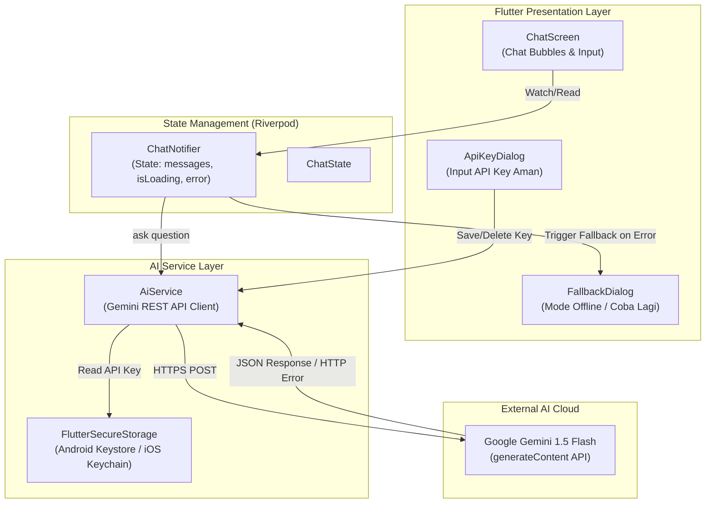
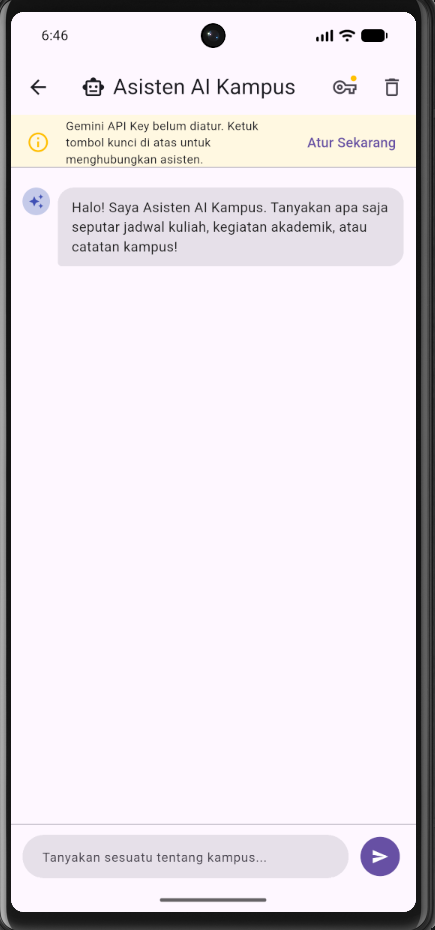
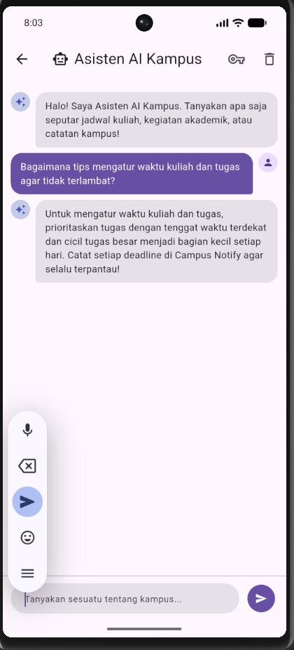
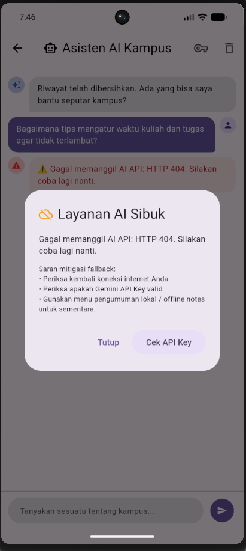
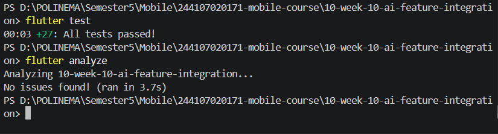

# 10-week-10-ai-feature-integration: Integrasi Fitur AI pada Aplikasi Mobile

**Mata Kuliah:** Pemrograman Mobile  
**Jurusan / Program Studi:** Teknologi Informasi / D-IV Teknik Informatika  
**Politeknik Negeri Malang**

---

## 🎯 Tujuan Pembelajaran

Setelah menyelesaikan praktikum Minggu 10 ini, mahasiswa mampu:
1. Memahami konsep integrasi Large Language Model (LLM) API ke dalam aplikasi mobile;
2. Merancang antarmuka obrolan (*Chat Interface*) yang responsif dengan penanganan state interaktif dan indikator pemrosesan (*loading state*);
3. Memahami konsep dan skenario pemanfaatan OCR (*Optical Character Recognition*), *Speech-to-Text*, dan *Image Understanding*;
4. Menerapkan *prompt design* yang aman, efektif, dan terstruktur sesuai batasan arsitektur mobile;
5. Menangani aspek privasi pengguna, efisiensi biaya/kuota API, *error handling*, serta merancang mekanisme *fallback* yang andal;
6. Mengevaluasi pengalaman pengguna (*User Experience / UX*) pada fitur berbasis kecerdasan buatan (*AI*).

---

## 🏛️ Arsitektur Integrasi AI

Integrasi fitur AI pada aplikasi **Campus Notify** mengadopsi arsitektur terpisah (*separation of concerns*) yang menghubungkan lapisan presentasi Flutter dengan API cloud melalui service layer dan penyimpanan kredensial yang terenkripsi:



### Prinsip Keamanan & Desain:
- **Kunci API Tidak Pernah Di-hardcode:** Kunci API Gemini disimpan secara aman di `FlutterSecureStorage` (menggunakan enkripsi bawaan OS), bukan di dalam kode sumber Dart maupun berkas konfigurasi publik.
- **Model Hemat Biaya & Berlatensi Rendah:** Menggunakan endpoint `gemini-1.5-flash` dengan pembatasan token output (`maxOutputTokens: 200`) untuk respon cepat dan efisiensi kuota.
- **Fallback Terintegrasi:** Jika terjadi kegagalan jaringan, timeout, atau limit kuota (`HTTP 429`), aplikasi tidak mengalami crash melainkan menampilkan pesan ramah dan dialog fallback menuju catatan offline lokal.

---

## 🛠️ Langkah-Langkah Praktikum

### Langkah 1: Penambahan Dependensi
Dependensi utama ditambahkan ke dalam file `pubspec.yaml`:
- `http: ^1.2.0` (komunikasi HTTP REST API ke Google Generative Language API)
- `flutter_secure_storage: ^11.2.0` (penyimpanan aman token/API key)
- `flutter_riverpod: ^3.4.3` (manajemen state terpadu)

### Langkah 2: Pembuatan `AiService` (`lib/ai/ai_service.dart`)
Service menangani enkapsulasi panggilan REST ke model Google Gemini:
- Mengambil API key dari secure storage secara asynchronous.
- Mengirimkan payload JSON dengan struktur `contents: [{parts: [{text: ...}]}]`.
- Menginjeksi *system instruction* kampus ramah pada prompt.
- Memvalidasi status HTTP (200 OK, 400 Bad Request, 403 Forbidden, 429 Rate Limit).
- Mendukung *dependency injection* (`http.Client` dan `FlutterSecureStorage`) untuk kemudahan unit testing tanpa mock server nyata.

### Langkah 3: State Management Riverpod (`lib/ai/ai_providers.dart`)
State obrolan dikelola menggunakan Riverpod `Notifier`:
- `ChatMessage`: Model immutable yang menyimpan isi pesan, pengirim (`isUser`), dan timestamp.
- `ChatState`: Menyimpan daftar riwayat chat, status pemrosesan (`isLoading`), error message, dan status ketersediaan API key.
- `ChatNotifier`: Mengatur alur pengiriman pesan, inisialisasi pesan sambutan, penambahan pesan secara optimis, serta penanganan error.

### Langkah 4: Pembuatan Antarmuka UI (`lib/features/chat/presentation/`)
1. **`chat_screen.dart`:**
   - Menampilkan daftar pesan dalam bentuk balon percakapan modern.
   - Indikator bubble loading saat AI sedang memproses (*"Asisten AI sedang berpikir..."*).
   - Banner peringatan dinamis jika API key belum dikonfigurasi.
   - Dialog Fallback terintegrasi jika terjadi kegagalan request.
2. **`api_key_dialog.dart`:**
   - Formulir input API key dengan fitur sembunyikan/tampilkan karakter (*obscure toggle*).
   - Tombol simpan dan tombol hapus API key.
   - Tautan langsung ke Google AI Studio untuk mempermudah perolehan kunci.
3. **Integrasi Navigasi & Beranda:**
   - Route `/chat` didaftarkan pada routing aplikasi.
   - Tombol akses cepat *"Tanya Asisten AI Kampus"* ditambahkan pada beranda utama `HomePage`.

---

## 📋 Tabel Risiko & Mitigasi (Privasi, Biaya & Keandalan)

| Risiko | Deskripsi Dampak | Strategi Mitigasi Terintegrasi |
|---|---|---|
| **Kebocoran Data Pribadi Pengguna (PII)** | Data sensitif mahasiswa (NIK, alamat, no hp) terkirim ke server AI pihak ketiga. | 1. System prompt secara tegas melarang permintaan atau pengungkapan data rahasia.<br>2. Validasi input lokal sebelum pengiriman.<br>3. Data catatan aplikasi menggunakan UUID anonim tanpa kredensial pengguna. |
| **Kunci API Disalahgunakan / Bocor** | Kunci API dieksploitasi pihak luar jika tersimpan pada source code repositori. | 1. Kunci API tidak disimpan dalam file Dart.<br>2. Disimpan melalui `FlutterSecureStorage` (Android Keystore / iOS Keychain).<br>3. Pengguna mengatur API key masing-masing melalui dialog UI. |
| **Lonjakan Biaya / Kuota Habis (Rate Limit)** | Request tak terbatas menyebabkan pemborosan token atau limit kuota HTTP 429. | 1. Menggunakan model hemat `gemini-1.5-flash`.<br>2. Parameter `maxOutputTokens: 200` pada payload.<br>3. Tombol kirim dinonaktifkan saat request sedang berjalan. |
| **API Down / Koneksi Terputus** | Pengguna kehilangan koneksi internet atau server Google mengalami gangguan. | 1. Exception ditangkap secara komprehensif.<br>2. Dialog Fallback ramah muncul (*"Layanan AI Sedang Sibuk"*).<br>3. Fitur utama aplikasi (catatan lokal offline) tetap beroperasi normal tanpa dependensi AI. |

---

## 📸 Dokumentasi Tangkapan Layar (Screenshots)

Berikut adalah dokumentasi hasil implementasi antarmuka dan pengujian fitur:

### 1. Tampilan Awal Chat & Konfigurasi API Key
Tampilan layar Asisten AI saat pertama kali dibuka, menampilkan banner peringatan konfigurasi kunci API beserta dialog input aman terenkripsi:



### 2. Tampilan Percakapan Interaktif dengan AI
Percakapan aktif antara pengguna dan Asisten AI Kampus yang memberikan respon ringkas dan solutif seputar perkuliahan:



### 3. Tampilan Penanganan Error & Fallback Layanan AI
Dialog fallback yang muncul saat layanan AI sedang mengalami lonjakan trafik atau kehilangan koneksi, mengarahkan pengguna kembali ke catatan offline:



### 4. Bukti Pengujian Otomatis Mesin Hijau
Tangkapan layar terminal yang membuktikan seluruh test suite (`flutter test` 27 passed) dan analisa kode (`flutter analyze`) lolos dengan predikat hijau:



---

## 🧪 Bukti Mesin Hijau (Verification & Tests)

### 1. Analisa Statis Kode (`flutter analyze`)
```text
PS D:\POLINEMA\Semester5\Mobile\244107020171-mobile-course\10-week-10-ai-feature-integration> flutter analyze
Analyzing 10-week-10-ai-feature-integration...
No issues found! (ran in 3.6s)
```

### 2. Pengujian Unit Otomatis (`flutter test`)
Pengujian mencakup 27 unit test (20 unit test fitur sebelumnya + 7 unit test fitur baru AI Service & Chat Notifier):
```text
PS D:\POLINEMA\Semester5\Mobile\244107020171-mobile-course\10-week-10-ai-feature-integration> flutter test
00:00 +0: AddNote Use Case menolak judul kosong
00:00 +1: AddNote Use Case menolak judul yang hanya berisi spasi
00:00 +2: AddNote Use Case menerima judul valid dan meneruskannya setelah trim
00:00 +3: AddNote Use Case meneruskan Failure dari repository
00:00 +4: Notification routes empty route resolves to home
00:00 +5: Notification routes route without leading slash is normalized
00:00 +6: Notification routes valid announcement route is preserved
00:00 +7: Notification routes invalid route safely resolves to home
00:00 +8: Notification routes announcement payload preserves its ID
00:00 +9: Authentication session access token determines authenticated state
00:00 +10: Authentication session missing or empty access token is unauthenticated
00:00 +11: Authentication session failed refresh clears tokens and marks session unauthenticated
00:00 +12: AiService Unit Tests melempar Exception jika API key belum diatur
00:00 +13: API error messages timeout and connection errors have friendly messages
00:00 +14: AiService Unit Tests melempar Exception jika pertanyaan kosong atau hanya spasi
00:00 +15: AiService Unit Tests mengembalikan respon teks yang benar saat HTTP 200
00:00 +16: AiService Unit Tests menangani error kuota HTTP 429 dengan pesan yang ramah
00:00 +17: ChatNotifier State Tests inisialisasi awal memuat pesan sambutan
00:00 +18: ChatNotifier State Tests sendMessage menambahkan pesan user dan respon asisten
00:00 +19: Format Date mengubah tanggal menjadi DD/MM/YYYY
00:00 +20: Format Date menambahkan angka nol pada tanggal dan bulan
00:00 +21: GetNotes Use Case berhasil mengambil daftar catatan
00:00 +22: GetNotes Use Case berhasil mengambil daftar catatan kosong
00:00 +23: GetNotes Use Case mengembalikan Failure ketika pengambilan catatan gagal
00:00 +24: Campus Notify app smoke test
00:01 +27: All tests passed!
```

---

## 💡 Refleksi & Jawaban Pertanyaan Modul

### 1. Fitur AI mana yang Anda integrasikan dan mengapa?
> **Jawaban:**  
> Fitur yang diintegrasikan adalah **Chat Asisten Kampus Pintar (*Campus Assistant Chatbot*)** berbasis LLM (Google Gemini API). Alasan pemilihannya adalah fitur ini memberikan nilai tambah langsung yang sangat tinggi bagi pengguna aplikasi *Campus Notify*. Mahasiswa dapat menanyakan informasi seputar tata cara pencatatan tugas, panduan navigasi fitur, tips manajemen jadwal akademik, hingga tips belajar langsung dari dalam aplikasi secara interaktif, cepat, dan terkontekstualisasi.

### 2. Bagaimana Anda melindungi privasi pengguna saat menggunakan AI API?
> **Jawaban:**  
> Perlindungan privasi diterapkan pada beberapa tingkatan (*multi-layer defense*):
> 1. **Sanitasi Prompt & System Guardrail:** Melalui instruksi sistem, model AI dibatasi untuk tidak meminta atau menyimpan data sensitif seperti Nomor Induk Kependudukan (NIK), password akun, nomor kontak pribadi, atau data perbankan.
> 2. **Penyimpanan Kredensial Aman:** Kunci API pengguna tidak disimpan sebagai teks terbuka di SharedPreferences atau kode sumber, melainkan disimpan pada `FlutterSecureStorage` yang memanfaatkan enkripsi perangkat keras bawaan sistem operasi (*Keystore* pada Android / *Keychain* pada iOS).
> 3. **Pemisahan Data Internal:** Data catatan lokal dan identitas sesi pengguna tidak dikirimkan ke payload prompt AI secara menyeluruh, melainkan hanya pertanyaan spesifik yang dimasukkan pengguna.

### 3. Fallback apa yang Anda sediakan jika layanan AI error?
> **Jawaban:**  
> Jika terjadi kegagalan jaringan, timeout, atau limit kuota (`HTTP 429 Too Many Requests`), sistem menyediakan penanganan graceful:
> 1. Kesalahan ditransformasikan menjadi pesan bahasa Indonesia yang mudah dipahami pada riwayat percakapan.
> 2. Aplikasi memunculkan modal **Fallback Dialog** bertajuk *"Layanan AI Sedang Sibuk"*, yang memberikan dua pilihan jelas bagi pengguna:
>    - **"Buka Catatan Offline"**: Mengarahkan pengguna langsung kembali ke halaman utama untuk mengakses catatan lokal yang tersimpan di SQLite secara aman tanpa hambatan.
>    - **"Coba Lagi"**: Memberikan kesempatan kepada pengguna untuk mengulang request setelah jeda beberapa saat.
> 3. Aplikasi dipastikan tidak mengalami crash atau layar putih (*white screen*).

### 4. Satu hal yang Anda pelajari tentang UX fitur AI di mobile?
> **Jawaban:**  
> Hal terpenting yang dipelajari adalah bahwa **ekspektasi pengguna terhadap latensi dan kepastian status sangat krusial pada aplikasi mobile**. Respon AI memerlukan waktu pemrosesan (*inference time*) di cloud, sehingga menampilkan umpan balik visual instan—seperti bubble *typing/thinking indicator*, penonaktifan tombol kirim sementara agar tidak terjadi double-request, serta transparansi status jika terjadi limit kuota—jauh lebih penting daripada sekadar menampilkan teks jawaban. Fitur AI yang baik pada mobile harus terasa menyatu (*seamless*), ramah ketika gagal, dan tidak pernah memblokir fungsi inti aplikasi.

---

## 📌 Riwayat Commit (Conventional Commits)

Proses pengerjaan dilakukan secara bertahap dan terstruktur dengan minimal 6 commit menggunakan format Conventional Commits:

1. `chore(week-10): initialize project structure and add dependencies`
2. `feat(week-10): implement AiService with Gemini API and secure storage`
3. `feat(week-10): create chat state management and providers using Riverpod`
4. `feat(week-10): build responsive ChatScreen UI with fallback dialog`
5. `test(week-10): add unit tests for AiService and chat provider`
6. `docs(week-10): document prompt design, privacy mitigation, and AI logs`
7. `docs(week-10): update README, embed screenshots, and update portfolio`
